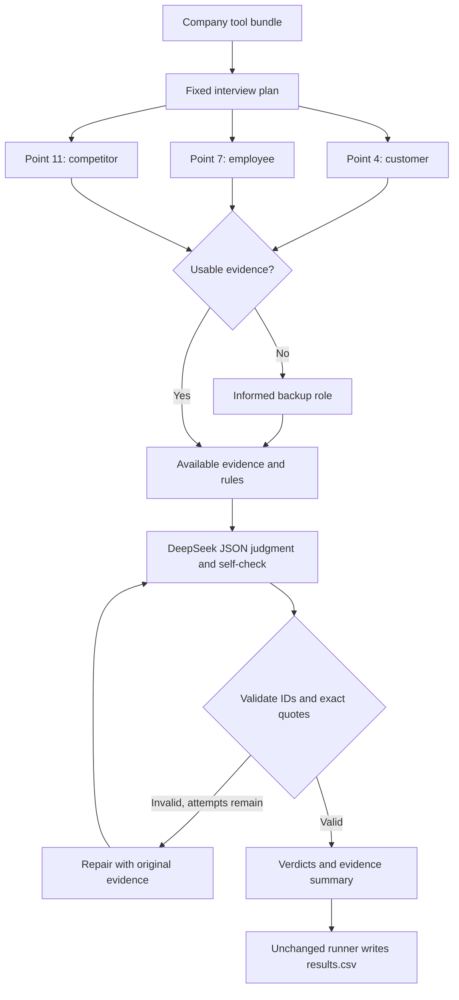

# FTEC5660 Homework 3: Fisher Interview Agent

**Student:** ZHANG Xiaoxuan  
**Student ID:** 1155266357  
**Selected Fisher points:** 4, 7 and 11  
**Model:** `deepseek-v4-flash` through LangChain

## Run

Use Python 3.10 or newer. Clone this public fork and install its dependencies:

```bash
git clone https://github.com/zhangxiaoxuan5678/FTEC5660-HW3.git
cd FTEC5660-HW3
python3 -m venv .venv
source .venv/bin/activate
pip install -r requirements.txt
```

Create a local `.env` file containing `DEEPSEEK_API_KEY=your_actual_key`.
The file is ignored by git and must never be uploaded. The grader supplies its
own key. Then run:

```bash
python3 hw3.py --data-folder public_test
```

The unchanged starter runner creates `results.csv` and prints the balanced
point score. To measure the public results and update the report automatically:

```bash
python3 evaluate_public.py
```

This command runs the actual agent before reading the public answer key. It
updates the Results section and creates `public_results.csv` only when all
companies have valid verdicts. Repeat it for additional independent runs if
required; each invocation makes new model calls.

Offline reliability checks (no key and no API requests):

```bash
python3 -m unittest -v test_hw3
```

## Homework 3 solution

### My 3 points and rules

I selected sales organization, personnel relations and competitive advantage.
These criteria address how a business sells, treats the people who operate it,
and sustains its position against rivals. They also suit Fisher's scuttlebutt
approach: informed people outside senior management can describe behavior that
financial statements and optimistic management language may overlook. The
point questions supplied in `FISHER_POINTS` anchor the rules below; the agent
does not treat a management claim as independent verification.

| Point | Why I chose it | PASS rule | Evidence |
| --- | --- | --- | --- |
| 4: Above-average sales organization | A capable sales team can translate products into repeat business and help customers solve problems. | PASS when an informed witness describes superior technical advice, proactive service, customer support or sales execution that distinguishes the team from rivals. FAIL when the team is passive, unhelpful, lacks expertise or loses business through poor execution; sending a price list alone is insufficient. | `interview(customer, sales_team)`; backup: `competitor`. |
| 7: Labour and personnel relations | Employee treatment affects organizational stability and the ability to execute a long-term strategy. | PASS when testimony describes constructive relations through fair treatment, reasonable and safe conditions, management listening or stable, committed staff. FAIL for persistent mistreatment, unresolved grievances, unsafe or unreasonable conditions, poor morale or high turnover. | `interview(current_employee, working_conditions)`; backup: `former_employee`. |
| 11: Advantage over competitors | An attractive business should have a meaningful reason for customers to prefer it that rivals cannot readily reproduce. | PASS when testimony identifies a defensible advantage such as specialized expertise, reliability, cost, service, integration or switching barriers. FAIL when offerings are interchangeable, readily copied or compete mainly on price without a durable differentiator. | `interview(competitor, competitive_edge)`; backup: `customer`. |

These are qualitative rules applied to meaning, including negation and
comparisons. The implementation does not match public interview phrases to
labels or impose a required number of PASS/FAIL decisions. Each point is
judged independently, so a company may pass one criterion and fail another.

### Agent design



The workflow uses LangChain tools for retrieval and `ChatDeepSeek` for semantic
judgment. A fixed plan routes each point to someone who knows the topic, rather
than spending interviews on uninformed roles. The three interviews run in
parallel, and up to four companies run concurrently. One model call normally
handles all three points, using point-specific rules and evidence; it also
performs a prompted self-check before returning JSON. Python then validates
point IDs, PASS/FAIL values, explanation lengths and the existence of every
quoted excerpt in its corresponding interview. Invalid responses trigger a
bounded repair call using the same evidence. The summary is assembled from
the validated decisions, with each source role and topic attached.

Only the supplied `interview` tool is needed for these selected criteria;
company files are never opened by the student inference code. The database
and management documents are reserved for other points and are not needed to
support these interview-based rules. Under the assignment's assumptions,
informed witnesses agree, so one usable answer per topic is sufficient.
Normally each company uses three interviews. An unusable response or tool
failure permits one informed backup per topic, making six the maximum,
within the ten-interview limit. Model retries never repeat interviews.

### Reliability and limitations

- Each model request has a 65-second outer timeout, with at most three
  attempts. A company has a 240-second outer limit. With four companies in
  flight, 20 companies have a nominal worst-case scheduling bound of about
  20 minutes, excluding setup and small tool/runner overhead; actual API
  runtime still needs measurement.
- JSON errors and quotation failures prompt repair. A quotation match checks
  source fidelity; it does not prove that the model's interpretation is
  correct. Semantic accuracy is assessed separately against the public key.
- Missing evidence for one point does not prevent judgment on other points.
  A company-level failure returns an entry with an explicit error summary,
  allowing the unchanged runner to write `results.csv` for the whole batch.
- Missing API credentials produce explicit missing verdicts. The agent does
  not silently replace an API failure with guessed PASS/FAIL labels; missing
  verdicts are correctly penalized by the starter's scorer.
- Interview contents are treated as data in the prompt. This instruction
  reduces the risk of following instructions embedded in evidence; it is not
  a formal guarantee against prompt injection.
- This is a three-criterion screen. It does not establish that a stock is
  appropriately valued or suitable for an investor, and it does not assess
  the other twelve Fisher points. The assignment's fictional evidence and
  agreement assumptions simplify the disagreements and selection bias that
  real interviews would involve.

### Results

<!-- PUBLIC_RESULTS_START -->
**Live DeepSeek public-test evaluation is pending.** No usable
`DEEPSEEK_API_KEY` was configured in the development environment. Therefore no
public-test point score, semantic success rate or disagreement list is claimed.
The complete report requires this section to be replaced with measured
results after `python3 evaluate_public.py` succeeds. The report is not yet a
fully validated final submission.

Twelve offline reliability tests passed. They cover JSON validation, invented
and misattributed quotations, duplicate IDs, invalid verdicts, interview
routing and budget, backup roles, partial tool failure, repair without
re-interviewing, company isolation, model failure and missing credentials.
These tests use synthetic evidence and a controlled model response; they do
not establish DeepSeek accuracy on the public companies.
<!-- PUBLIC_RESULTS_END -->

The balanced metric is the mean of true-PASS recall and true-FAIL recall.
Unlike ordinary accuracy, it penalizes a strategy that labels every point
PASS. The public key is used only after inference by the unchanged starter
scorer and by `evaluate_public.py` for reporting. No public labels or
company-specific decisions are embedded in the agent.

### Reference

Philip A. Fisher, *Common Stocks and Uncommon Profits*, Part One, Chapters 3
and 4. The three question texts are provided in the instructor's
`FISHER_POINTS` mapping. Assignment specification: *Individual Homework 03*,
Agentic AI for Business and FinTech (SEEM5660).

## Task 2: Reflection on AI-sycophancy and AI-psychosis

AI-sycophancy is a tendency for an AI assistant to accommodate a user's views
or expectations even when evidence does not support them. An answer may feel
helpful because it agrees with the user, while actually weakening the user's
decision. In this reflection, I use the informal expression AI-psychosis to
discuss a more harmful feedback loop: an AI conversation may reinforce a
person's unsupported or distorted beliefs until the person increasingly
relies on the conversation as confirmation. This expression should not be
used as a diagnosis, and an investment agent should not attempt to diagnose
people.

The two problems share a concern about the difference between reassuring
language and justified confidence. If a user says, "I am sure this company is
excellent; explain why," a sycophantic investment assistant may select only
positive evidence. Repeated agreement can make an uncertain interpretation
feel settled. A more serious feedback loop can develop when the user treats
the assistant as an authority and interprets each agreeable response as
independent proof, even though the assistant has introduced no new evidence.
Repeated model responses are not independent confirmations of a claim.

Designing this Fisher agent makes that distinction concrete. The agent must
not call every company attractive because that sounds encouraging. A
customer's report of poor technical support may justify FAIL on sales
organization, even if management sounds confident elsewhere. Likewise, a
company can have a capable sales team while treating its employees poorly.
Giving one positive judgment should not create a positive narrative that
spills into the other points. I therefore use separate rules and evidence
for each criterion, and I avoid giving the model a target percentage of
passing companies.

The workflow also separates evidence collection from judgment. The model
receives interview statements obtained through the authorized tool, and it
must attach an exact excerpt to every verdict. Python checks that the excerpt
exists in the correct interview. This makes fabricated support easier to
catch and provides a reviewer with something specific to challenge. However,
a genuine quotation can still be misunderstood or selected unfairly. Exact
quotation checking improves traceability; it cannot replace semantic testing
or human judgment.

Uncertainty should also be visible. When the API fails or the interview is
unavailable, the agent records the failure instead of producing a reassuring
answer. Similarly, I should not report a high public-test score before
running the required model. A polished explanation is not evidence that the
system works. Testing must distinguish software reliability, public-test
performance and performance on unseen companies.

For a conversational assistant, my preferred behavior is to acknowledge a
person's concern while asking what evidence supports a claim, considering
alternative explanations, and stating uncertainty clearly. If a conversation
appears to be intensifying distress or encouraging harmful decisions, the
assistant should avoid amplifying the unsupported belief and encourage
appropriate human support. It should not present itself as an exclusive
source of truth or encourage isolation from other people.

My main responsibility as the designer is to make disagreement possible and
reviewable. The system should earn trust through evidence, clear limits and
correction. Users should be able to see why a verdict was produced, identify
what is missing, and decide when the question needs a human review.

### AI assistance acknowledgement

AI assistance was used to draft the implementation, documentation and this
reflection. Offline reliability tests are distinguished from live model
evaluation above. No unperformed experiments or personal experiences are
claimed.
